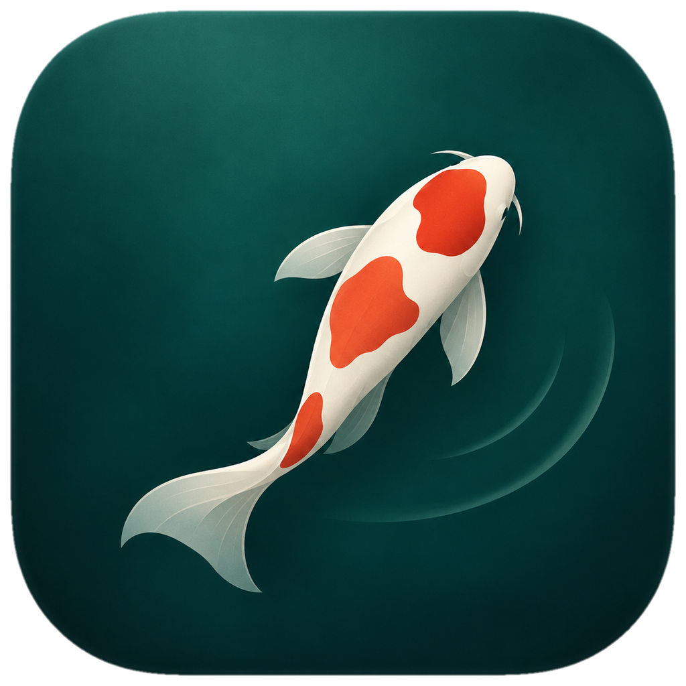
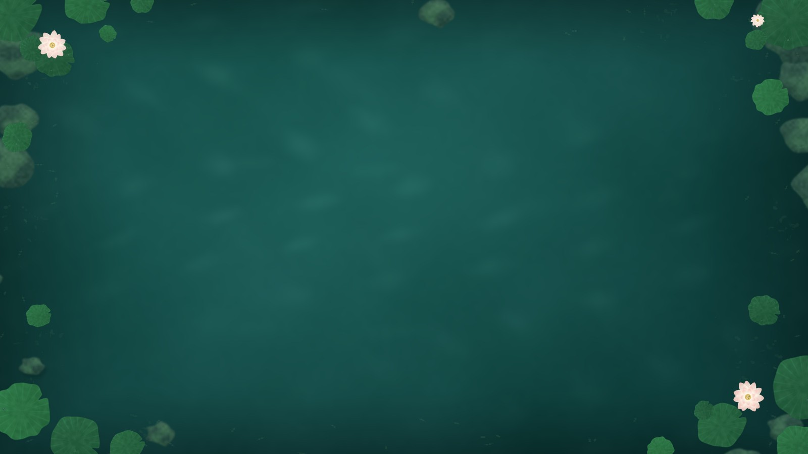
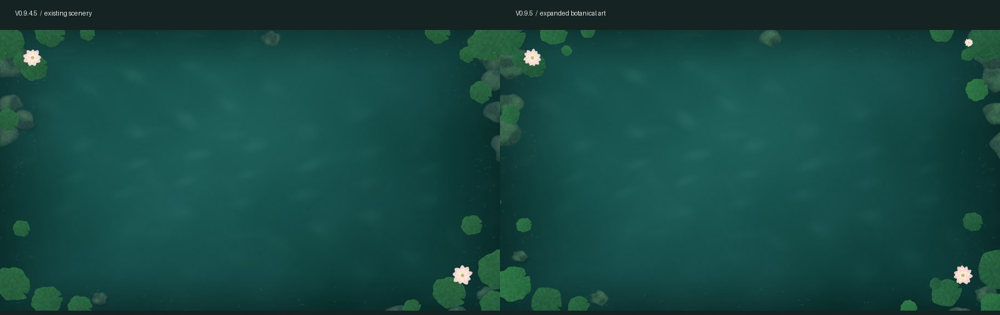

<h1 align="center">一池清宁 · Living Pond V1.1.2</h1>

<p align="center">
  <br>
  <strong>稳定收敛候选版 · macOS 原生（Swift / AppKit / SpriteKit）桌面锦鲤鱼缸</strong>
</p>

<p align="center"></p>

<p align="center">
  <a href="preview/real-rain-15s.mp3">▶ 试听 15 秒细雨声</a><br>
  <sub>Tim Kahn《Light Forest Rain》· CC BY 4.0 · 本项目加工版本，署名与改动见 <a href="Resources/Sound/ATTRIBUTION.txt">ATTRIBUTION.txt</a></sub>
</p>

回到已经成熟的 11 条鱼：**3 条大鱼 + 8 条小鱼**。不再包含 26 条微型群游鱼、领游轨迹、群游菜单或实验代码。本工程以 V1.0.0 的 11 鱼原生场景为基础，保留其 AppKit/SpriteKit、投食浮层、声音、细雨和低功耗/诊断。

## 这次修订

- 正式应用名称固定为 **「一池清宁.app」**，版本号只在「关于」和诊断里显示，以后可原位置更新，而不是每次多出一个 App 图标。
- Bundle ID 改为长期固定的 `studio.livingpond.app`。首次启动有限迁移旧版的雨声/雨效/音量/省电偏好；**不会迁移群游实验设置，也不会自动开启登录时启动**。
- 使用用户亲自选定的「极简青金锦鲤」图标，所有尺寸的 iconset 均来自 V1.1.1 已提供图标资源；本机 iconutil 生成 ICNS。
- 新旧应用并存；**安装绝不删除旧版本**。`Review-Old-Versions.sh` 是可选清理工具：默认仅列出历史版本，必须另加 `--trash` 并在交互式终端输入确切确认文字才会将旧 App 移到废纸篓。不会碰 ZIP、偏好设置、自定义雨声或当前「一池清宁.app」。
- 继续保留静态深青绿池水、11 条锦鲤、真实 Tim Kahn 细雨声及细雨涟漪、投食颗粒与鱼群互动、Esc/「完成」退出、桌面图标操作、暂停/恢复、登录启动手动选项、30 分钟日志。

## 安装（Intel iMac / macOS 13+）

请先从旧鱼塘菜单主动退出所有运行中的版本。解压工程到 `~/Downloads/LivingPond-V1.1.2-Native/`，打开终端执行：

```bash
/bin/bash "$HOME/Downloads/LivingPond-V1.1.2-Native/Install-V112.sh"
```

安装脚本在 `~/Applications` 创建临时构建区域，由 Mac **本机离线编译** Swift/AppKit/SpriteKit 源码、生成图标、临时签名、校验，再安装为：

`~/Applications/一池清宁.app`

如果此前已有同名正式应用，脚本会先备份至 `~/Library/Application Support/LivingPond/AppBackups`，不会覆盖历史版本文件。没有预编译 `.app`、没有需双击的 `.command`，也不需要关闭 Gatekeeper。

如需诊断：

```bash
/bin/bash "$HOME/Downloads/LivingPond-V1.1.2-Native/Diagnostics-V112.sh"
```

安装日志：`~/Library/Logs/LivingPond/build-v1.1.2.log`；长期稳定性日志：`~/Library/Logs/LivingPond/stability-v1.1.2.log`。

## 旧版清理（可选，绝不自动执行）

```bash
# 只预览历史版本：
/bin/bash "$HOME/Downloads/LivingPond-V1.1.2-Native/Review-Old-Versions.sh"
# 仅在你确认不再需要旧 App、全部旧版都已退出后才执行：
/bin/bash "$HOME/Downloads/LivingPond-V1.1.2-Native/Review-Old-Versions.sh" --trash
```

第二条必须在交互式终端输入 `MOVE TO TRASH` 才会继续。它只匹配 `~/Applications/LivingPond Native V*.app`，不会删除当前版本。仍建议先将旧版作为回退保留至正式封板。

## macOS 真机验收清单

1. 应用以「一池清宁」名称和新图标出现；原来的版本号 App 不被删除。
2. 11 条鱼自由巡游，没有群游白点或跟随菜单；3 大 8 小。
3. Finder 桌面图标正常点击与排列，Dock 不受阻碍；投食时浮层在右上角，鱼食可见，Esc / 完成退出。
4. 细雨雨声、雨纹、声音设置和导入状态正常；无动态风浪。
5. 30 分钟运行 + Space 切换 + 睡眠唤醒，检查 FPS、长帧、CPU/RSS 和声音恢复；登录时启动选项须手动启用/关闭验证。
6. 重启程序后用户选项正确保留，退出时桌面不残留遮挡层。

**质量状态：V1.1.2 Release Candidate**。Linux 环境能检查 Swift 语法及纯 Swift 测试，但不能代替 Intel macOS 编译、UI 实机体验、代码签名及长时间性能验收。只有用户真机确认后才可标为 Stable。

内置 Tim Kahn《Light Forest Rain》录音的署名与 CC BY 4.0 许可，见 `Resources/Sound/ATTRIBUTION.txt`。

## 开发素材存档

以下为开发过程的对比记录，**非当前版本实际画面**，保留供追溯用。


